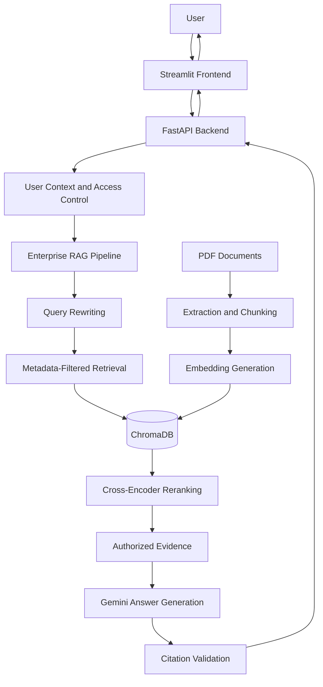

# Task 2 — EnterpriseRAG
## Secure Enterprise Retrieval-Augmented Generation with Role-Based Access Control (RBAC)

EnterpriseRAG is a Python-based Retrieval-Augmented Generation (RAG) application designed to retrieve information from enterprise documents and generate context-grounded answers while enforcing access restrictions. It combines semantic search, persistent vector storage, document metadata filtering, query rewriting, cross-encoder reranking, source citations, and a web interface backed by a REST API.

A key feature of this project is **Role-Based Access Control (RBAC)**. The retrieval pipeline uses user identity, tenant information, and clearance levels to restrict which document chunks a user can access. This helps prevent unauthorized information from entering the language model's context.

This project was developed as part of the **Datheon Forward Deployed Internship**.

---

## Table of Contents

1. Project Overview
2. Problem Statement
3. Project Objectives
4. Key Features
5. Role-Based Access Control (RBAC)
6. Access Clearance Levels
7. Tenant Isolation and Data Security
8. Technology Stack
9. System Architecture
10. End-to-End RAG Workflow
11. Retrieval and Reranking
12. Answer Generation and Citations
13. Conversation Intent Routing
14. Project Structure
15. Prerequisites
16. Installation and Setup
17. Environment Configuration
18. Running the Application
19. FastAPI Endpoints
20. Query Processing
21. Document Upload and Ingestion
22. Streamlit User Interface
23. Error Handling
24. Testing
25. Security Considerations
26. Configuration and Customization
27. Design Decisions
28. Current Scope and Limitations
29. Future Improvements
30. Troubleshooting
31. Internship Information
32. Conclusion

---

## 1. Project Overview

Enterprise documents often contain information with different sensitivity levels. Contracts, internal reports, confidential records, and restricted documents should not be equally accessible to every employee or application user.

A conventional RAG system retrieves relevant document chunks and passes them to a language model. However, relevance alone is insufficient for enterprise use. The system must also determine whether the requesting user is authorized to access the retrieved information.

EnterpriseRAG addresses this challenge by combining semantic retrieval with access-aware filtering.

The application provides:

- PDF document ingestion.
- Text extraction and chunking.
- Embedding generation using Sentence Transformers.
- Persistent vector storage with ChromaDB.
- Semantic retrieval of relevant document chunks.
- Tenant-aware document filtering.
- Role and clearance-based access restrictions.
- Query rewriting to improve retrieval.
- Cross-encoder reranking of retrieved passages.
- Gemini-based answer generation.
- Source and page references for answers.
- Citation validation against retrieved evidence.
- A FastAPI backend.
- A Streamlit frontend.
- Automated tests for core functionality.

The primary design principle is:

**Retrieve relevant information only from the documents the requesting user is authorized to access, then generate an answer using that permitted evidence.**

---

## 2. Problem Statement

Enterprise knowledge is frequently distributed across documents containing different levels of sensitivity. Employees need to retrieve useful information efficiently without being exposed to records outside their permissions.

A basic document chatbot may introduce several problems:

- Keyword searches may fail when the user's wording differs from the document.
- Long documents can exceed practical context limits when passed directly to a language model.
- Similar documents may contain overlapping but differently relevant information.
- Answers may include unsupported statements if the model is not grounded in retrieved evidence.
- Users from different tenants may have different data-access boundaries.
- Users with different clearance levels should not receive the same information.
- Retrieved documents must retain source information so answers can be traced back to their evidence.
- Application behavior should be testable and accessible through defined API endpoints.

EnterpriseRAG addresses these concerns through an access-aware RAG pipeline that combines vector retrieval, authorization filters, reranking, grounded generation, and source validation.

---

## 3. Project Objectives

The main objectives of the project are:

1. Build an end-to-end enterprise document RAG application.
2. Extract readable text from PDF documents.
3. Divide document text into manageable chunks.
4. Generate vector embeddings for semantic retrieval.
5. Store document chunks and metadata persistently.
6. Apply tenant-aware access restrictions during retrieval.
7. Implement RBAC-style clearance enforcement.
8. Support multiple document sensitivity levels.
9. Improve retrieval using query rewriting.
10. Improve ranking using a cross-encoder reranker.
11. Generate answers using the Gemini language model.
12. Associate answers with document and page references.
13. Validate citations against retrieved evidence.
14. Expose application functionality through FastAPI.
15. Provide an interactive Streamlit interface.
16. Route simple conversational messages without unnecessary document retrieval.
17. Maintain modular components that can be tested independently.

---

## 4. Key Features

### 4.1 Document ingestion

PDF documents are processed to extract text and prepare it for retrieval.

The ingestion workflow separates document processing from question answering, allowing indexed content to be reused across queries.

### 4.2 Semantic search

Text chunks and user queries are represented as embeddings. ChromaDB uses these representations to retrieve semantically relevant document chunks.

Semantic retrieval helps find related information even when the user's wording differs from the source text.

### 4.3 Persistent vector storage

ChromaDB maintains a persistent vector collection so that indexed content can be reused between application runs, subject to the configured storage location and ingestion process.

### 4.4 Access-aware retrieval

Retrieval is constrained by metadata representing tenant ownership and document clearance.

The application applies access restrictions before the retrieved content is used for answer generation.

### 4.5 Query rewriting

The system can rewrite a question to improve its suitability for document retrieval. This is useful when a question is ambiguous, conversational, or expressed differently from the wording used in a source document.

### 4.6 Cross-encoder reranking

An initial retrieval stage finds candidate chunks. A cross-encoder reranker then evaluates the relevance of candidate passages to the query and improves their ordering.

### 4.7 Grounded answer generation

Gemini generates responses using retrieved document evidence rather than relying solely on its general training knowledge.

The quality of the response still depends on the relevance and completeness of the retrieved context.

### 4.8 Source citations

The application supports source and page references for retrieved evidence so users can inspect where an answer originated.

Citation validation checks whether referenced sources and pages exist in the retrieved evidence. It should not be interpreted as a complete verification that every statement is entailed by its citation.

### 4.9 REST API

FastAPI exposes endpoints for application health checks, document querying, and document uploads.

### 4.10 Interactive frontend

Streamlit provides a browser-based interface for interacting with the document-question-answering workflow.

### 4.11 Conversational intent routing

Simple messages such as greetings, thanks, and goodbyes can be handled through deterministic intent patterns without invoking the full RAG pipeline.

---

## 5. Role-Based Access Control (RBAC)

### 5.1 What is RBAC?

Role-Based Access Control is an authorization approach in which permissions are assigned according to a user's role rather than granting every user unrestricted access.

In an enterprise document system, different users may have different responsibilities and access privileges. A general employee should not automatically receive access to confidential contracts or restricted records simply because those records are relevant to a question.

EnterpriseRAG implements an access-control layer that uses user information, tenant boundaries, and clearance metadata to constrain document retrieval.

### 5.2 Why RBAC is important in RAG

A RAG system can expose sensitive information if it retrieves unauthorized content and includes it in the language model's prompt.

For example, suppose a user asks:

"What are the terms of the restricted agreement?"

If the system retrieves a restricted document before checking permissions, the model may receive information the user should not see.

The correct sequence is to enforce authorization before the protected content reaches the answer-generation stage.

EnterpriseRAG therefore treats authorization as part of retrieval rather than relying on the language model to decide whether information should be disclosed.

### 5.3 RBAC implementation approach

The access-control workflow follows these principles:

1. Identify the requesting user through the application's configured user context.
2. Obtain the user's tenant and access-clearance information.
3. Construct retrieval restrictions using the user's permitted scope.
4. Apply those restrictions to document metadata during retrieval.
5. Exclude documents that do not satisfy the authorization constraints.
6. Rerank the permitted retrieval results.
7. Pass authorized evidence to the answer-generation stage.
8. Return the answer with applicable source references.

The retrieval layer is responsible for applying access restrictions. The language model is not the authorization authority.

### 5.4 Access-control metadata

Document chunks can carry metadata representing their access requirements.

Typical fields used by this design include:

| Metadata field | Purpose |
|---|---|
| `tenant_id` | Identifies the tenant that owns the document |
| `access_tier` | Identifies the document's required clearance |
| `source` | Identifies the originating document |
| `page` | Identifies the source page where available |

The exact metadata schema depends on the ingestion implementation. Metadata must be populated consistently for access filtering to work correctly.

### 5.5 Authorization enforcement

A document should be eligible for retrieval only when it satisfies the application's tenant and clearance rules.

Conceptually:

```python
authorized = (
    document.tenant_id == user.tenant_id
    and document.clearance_level <= user.clearance_level
)
```

This is a simplified illustration of the authorization policy, not a substitute for the application's actual filtering implementation.

The important requirement is that authorization constraints are applied to the retrieval operation itself, before the resulting text is passed to the language model.

### 5.6 Defense in depth

Access control should not depend on a single prompt instruction.

The application uses metadata-based retrieval constraints as a structural boundary. Additional production safeguards should include trusted identity verification, server-side authorization, upload-time metadata validation, and tests that attempt unauthorized cross-tenant and cross-clearance access.

### 5.7 RBAC scope and production readiness

The project includes a demo user registry in `api/dependencies.py`. This is useful for demonstrating access-aware behavior, but it is **not a complete production identity and authentication system**.

For production deployment, the demo identity mechanism should be replaced with a trusted authentication provider and securely managed identities, roles, and permissions.

---

## 6. Access Clearance Levels

EnterpriseRAG uses a four-level document sensitivity model.

| Clearance level | Numeric value | Intended access scope |
|---|---:|---|
| Public | 0 | Information intended for general access |
| Internal | 1 | Information intended for authorized organizational users |
| Confidential | 2 | Sensitive business information requiring higher clearance |
| Restricted | 3 | Highly sensitive information requiring the highest configured clearance |

The numeric ordering enables the application to compare a user's clearance with a document's required clearance.

For example, under the clearance policy:

```text
Public       = 0
Internal     = 1
Confidential = 2
Restricted   = 3
```

A user with clearance level `1` can access documents at levels `0` and `1`, provided the tenant restriction is also satisfied.

A user with clearance level `2` can access documents at levels `0`, `1`, and `2`, again subject to tenant authorization.

A user with clearance level `3` can access documents across all four levels within the tenant and scope they are authorized to access.

### Important distinction

A clearance level is not, by itself, a complete RBAC policy.

A robust authorization decision should consider at least:

- The authenticated user's identity.
- The user's assigned role or permissions.
- The user's tenant.
- The document's tenant.
- The document's required clearance.
- Any additional policy restrictions.

The numeric comparison is an access-clearance rule used within the broader access-control design.

---

## 7. Tenant Isolation and Data Security

### 7.1 What is tenant isolation?

Tenant isolation ensures that data belonging to one customer, organization, or business unit is not unintentionally exposed to another.

In a multi-tenant RAG application, semantic similarity must never override ownership boundaries.

A document belonging to Tenant A should not be returned to a user from Tenant B merely because it is highly relevant to the query.

### 7.2 Tenant-aware retrieval

EnterpriseRAG combines tenant restrictions with clearance restrictions.

Conceptually, the retrieval policy is:

```text
Document is retrievable when:

1. The document belongs to the authorized tenant.
2. The user's clearance satisfies the document's requirement.
3. The document satisfies any additional configured access rules.
```

These restrictions should be applied as part of the database retrieval operation, not as a post-processing step that exposes unauthorized content to the language model.

### 7.3 Metadata integrity

Metadata is security-relevant. If a confidential document is incorrectly indexed as public, a correct filtering implementation can still return it to an insufficiently privileged user.

Consequently:

- Tenant metadata should be assigned from trusted application context.
- User-submitted metadata should not be trusted without validation.
- Clearance values should be validated against the supported model.
- Missing or malformed security metadata should not silently grant broader access.
- Upload and ingestion processes should preserve the intended access labels.
- Tests should cover missing, malformed, and conflicting metadata.

### 7.4 Limits of metadata filtering

Metadata filtering is only effective when the application supplies correct metadata and enforces the intended policy consistently.

Production deployment should also review vector-store access, API authentication, authorization failures, audit logging, and any administrative upload functionality.

---

## 8. Technology Stack

| Technology | Purpose |
|---|---|
| Python 3.12 | Main programming language |
| FastAPI | REST API framework |
| Uvicorn | ASGI server |
| Streamlit | Interactive web interface |
| LangChain | Language-model and retrieval integration |
| Google Gemini | Answer generation and configured LLM operations |
| Sentence Transformers | Text embedding and reranking support |
| ChromaDB | Persistent vector storage and similarity search |
| PyMuPDF | PDF text extraction |
| Pydantic | Data validation and request/response schemas |
| pytest | Automated testing |
| python-dotenv / environment configuration | Local configuration management where configured |

Exact package versions are maintained in the project's dependency files.

---

## 9. System Architecture

EnterpriseRAG is organized into a frontend, API, retrieval pipeline, access-control layer, vector store, and language-model integration.



### Architectural responsibilities

**Streamlit frontend**

Provides the interactive user interface.

**FastAPI backend**

Handles API requests and connects the interface to the application pipeline.

**User context and access control**

Supplies the user's configured identity and authorization context.

**Query rewriting**

Improves the question representation before retrieval when appropriate.

**Metadata-filtered retrieval**

Searches for relevant chunks within the user's permitted data scope.

**ChromaDB**

Stores embeddings, text chunks, and document metadata.

**Cross-encoder reranking**

Reorders candidate passages based on their relevance to the query.

**Gemini**

Generates the final response using the retrieved evidence.

**Citation validation**

Checks that source and page references correspond to retrieved evidence.

---

## 10. End-to-End RAG Workflow

### Phase A: Document ingestion

1. A PDF is supplied to the ingestion workflow.
2. PyMuPDF extracts text from the document.
3. The extracted text is divided into manageable chunks.
4. Relevant source and access metadata are attached to the chunks.
5. The embedding model converts chunks into vector representations.
6. ChromaDB stores the vectors, text, and metadata persistently.

### Phase B: Question processing

1. A user submits a question through the frontend or API.
2. The backend establishes the configured user context.
3. The intent router determines whether the input is a supported simple conversational intent.
4. If it is a document question, the RAG pipeline processes it.
5. Query rewriting improves the retrieval query when applicable.
6. The retrieval layer applies tenant and clearance restrictions.
7. ChromaDB returns candidate chunks from the permitted scope.
8. A cross-encoder reranks the candidates.
9. The pipeline selects relevant evidence for the answer.

### Phase C: Answer generation

1. The question and selected evidence are assembled into the generation context.
2. Gemini generates a response.
3. Source references are checked against retrieved evidence.
4. The response is returned through FastAPI.
5. The frontend displays the answer and available source references.

The central security property is that unauthorized chunks should not be included in the context sent to the language model.

---

## 11. Retrieval and Reranking

### 11.1 Embedding-based retrieval

An embedding model maps text to a numerical vector. Semantically related passages can have similar vector representations even when they do not share the same keywords.

This supports questions expressed in natural language.

### 11.2 Vector search

ChromaDB stores document embeddings and searches for candidate chunks relevant to a query.

The retrieval stage focuses on identifying promising candidates rather than generating the final answer itself.

### 11.3 Metadata filtering

The vector search is constrained using document metadata, including tenant and access-clearance information.

The system should not retrieve a restricted passage and rely on the LLM to hide it later.

### 11.4 Query rewriting

Query rewriting can transform an ambiguous or conversational question into a more useful search query.

For example:

```text
Original question:
"What did it say about the renewal?"

Possible retrieval-oriented query:
"Find the agreement's contract renewal terms and conditions."
```

This is an illustrative example. The actual rewrite depends on the user's question and the configured rewriting logic.

### 11.5 Cross-encoder reranking

A bi-encoder embedding model efficiently retrieves candidates from a large collection. A cross-encoder then evaluates query-passage relevance more directly.

The reranking process helps prioritize passages that are more useful for answering the question.

Reranking improves ordering; it does not replace authorization checks or guarantee that the final answer is correct.

### 11.6 Evidence selection

Only appropriately filtered and selected chunks should be passed into answer generation.

This reduces irrelevant context and helps the language model produce a more focused answer.

---

## 12. Answer Generation and Citations

### 12.1 Grounded generation

The answer-generation stage uses retrieved evidence as context for Gemini.

The intended behavior is to answer using the available documents and avoid presenting unsupported assumptions as established facts.

A RAG architecture reduces dependence on general model knowledge for document-specific answers, but it does not eliminate hallucinations.

### 12.2 Source references

Source references help users locate the documents supporting a response.

Where available, the reference can identify:

- The source document.
- The relevant page.
- The retrieved evidence associated with the answer.

### 12.3 Citation validation

The implemented validation checks whether cited source and page references exist in the retrieved evidence.

This is a useful consistency check, but it is not equivalent to semantic entailment verification.

A citation may refer to a valid page without that page actually supporting every sentence in the answer.

### 12.4 Potential improvements

More advanced citation validation could include:

- Checking whether each answer claim is supported by its cited passage.
- Returning citations at the chunk or sentence level.
- Detecting conflicting evidence.
- Rejecting unsupported claims.
- Evaluating factual faithfulness against a test dataset.

---

## 13. Conversation Intent Routing

A document-question-answering application does not need to run vector search for every user message.

For example, a greeting such as "Hello" does not require document retrieval.

EnterpriseRAG includes deterministic intent patterns for supported conversational inputs, including:

- Greetings.
- Simple "how are you" messages.
- Expressions of thanks.
- Goodbyes.
- Questions about the application's capabilities.

When a supported conversational intent is detected, the application can return a direct conversational response rather than invoking the complete retrieval workflow.

This approach can reduce unnecessary retrieval and model calls for common conversational messages.

The router is a lightweight intent mechanism, not a general-purpose chatbot fallback. Inputs that do not match supported patterns may continue through the document-question-answering workflow.

---

## 14. Project Structure

The main application is organized into modules for the API, conversation handling, document processing, and RAG pipeline.

```text
Task_2_EnterpriseRAG/
│
├── app.py
├── pyproject.toml
├── requirements.txt
├── .gitignore
│
├── src/
│   └── enterprise_rag/
│       ├── __init__.py
│       ├── pipeline.py
│       │
│       ├── api/
│       │   ├── main.py
│       │   └── dependencies.py
│       │
│       └── conversation/
│           └── intent_router.py
│
└── tests/
    ├── ...
    └── ...
```

The tree above highlights the primary files and modules. Additional modules may exist in the working project.

### Important files

| File | Responsibility |
|---|---|
| `app.py` | Streamlit frontend entry point |
| `src/enterprise_rag/pipeline.py` | Main RAG orchestration and query workflow |
| `src/enterprise_rag/api/main.py` | FastAPI application and API routes |
| `src/enterprise_rag/api/dependencies.py` | API dependencies and demo user registry |
| `src/enterprise_rag/conversation/intent_router.py` | Deterministic conversational intent routing |
| `requirements.txt` | Python dependencies |
| `pyproject.toml` | Project and build configuration |
| `.gitignore` | Excludes local secrets and generated files |
| `tests/` | Automated tests |

---

## 15. Prerequisites

Before running the application, install or prepare the following:

- Python 3.12.
- pip.
- Git, if cloning the repository.
- A valid Google Gemini API key.
- Internet connectivity for configured hosted model services and model downloads.
- Sufficient disk space for embedding models and the local vector database.

A virtual environment is recommended to isolate project dependencies.

---

## 16. Installation and Setup

### Step 1: Open the project directory

From PowerShell:

```powershell
cd "C:\Users\mahee\OneDrive\Desktop\PROJECTS\Datheon_Forward_Deployed_Engineering_Internship\Task_2_EnterpriseRAG"
```

Adjust the path if your repository is located elsewhere.

### Step 2: Create a virtual environment

```powershell
python -m venv .venv
```

### Step 3: Activate the virtual environment

```powershell
.\.venv\Scripts\Activate.ps1
```

If PowerShell blocks script activation, use an approved environment-specific activation method or invoke the virtual environment's Python executable directly.

### Step 4: Upgrade pip

```powershell
python -m pip install --upgrade pip
```

### Step 5: Install dependencies

```powershell
python -m pip install -r requirements.txt
```

Wait for the dependencies to finish installing before starting the application.

### Step 6: Configure the environment

Create the local `.env` file and provide the required Gemini API key, as described in the next section.

---

## 17. Environment Configuration

The application requires a valid Google Gemini API key for the configured Gemini integration.

Create a file named `.env` in the project root:

```dotenv
GEMINI_API_KEY=your_gemini_api_key_here
```

Replace the placeholder with your own valid key.

If the implementation uses a different environment variable name, follow the name expected by the configured model client.

### Security requirements

- Never commit `.env` to Git.
- Never place a real API key in the README.
- Never share API keys in screenshots, logs, or public repositories.
- Keep `.env` excluded through `.gitignore`.
- Rotate any key that is accidentally exposed.
- Use managed secrets and restricted credentials in production.

The project configuration should load environment variables before initializing the Gemini client.

---

## 18. Running the Application

EnterpriseRAG provides a FastAPI backend and a Streamlit frontend.

### 18.1 Start the FastAPI backend

Open a terminal in the project root, activate the virtual environment, and run:

```powershell
python -m uvicorn enterprise_rag.api.main:app --reload --app-dir src
```

The backend runs locally using Uvicorn.

The `--reload` option is intended for development and automatically reloads the server when relevant source files change.

### 18.2 Open the FastAPI documentation

Once the server starts, open:

```text
http://127.0.0.1:8000/docs
```

FastAPI's interactive documentation allows you to inspect the available endpoints and try requests using their declared schemas.

The root address is:

```text
http://127.0.0.1:8000
```

### 18.3 Start the Streamlit frontend

Open a second terminal in the project root and activate the same virtual environment.

Run:

```powershell
python -m streamlit run app.py
```

Streamlit prints the local address in the terminal. Open that address in your browser.

### 18.4 Recommended startup order

1. Start the FastAPI backend.
2. Confirm that the backend is healthy.
3. Start the Streamlit frontend.
4. Use the interface to submit a question or upload a document.
5. Review the answer and available source references.

Keep the backend terminal running while using the frontend if the frontend is configured to call the local API.

---

## 19. FastAPI Endpoints

The application exposes the following core routes.

| Endpoint | Method | Purpose |
|---|---|---|
| `/health` | GET | Checks the health of the backend |
| `/query` | POST | Processes a question through the RAG workflow |
| `/upload` | POST | Accepts a document upload for ingestion |

Consult the live OpenAPI documentation at `/docs` for the exact request schemas, parameters, and response formats implemented in the current version.

### 19.1 Health check

Send a GET request to:

```text
http://127.0.0.1:8000/health
```

This endpoint can help confirm that the API process is responding.

A successful health check does not necessarily prove that every external dependency, model, or vector-store operation is working.

### 19.2 Query endpoint

The query endpoint accepts a question and processes it through the configured retrieval and generation pipeline.

The workflow includes access-aware retrieval, evidence selection, answer generation, and source-reference validation where applicable.

The exact JSON body should be obtained from the request schema in `/docs`, since the accepted fields depend on the API implementation.

### 19.3 Upload endpoint

The upload endpoint accepts a document for processing according to the implemented upload schema.

Ingestion must preserve the document's intended tenant and clearance metadata. A production deployment should never allow an untrusted caller to assign arbitrary privileged metadata to their own upload.

### 19.4 API security

The API should be deployed behind a trusted authentication and authorization layer before it is exposed to external users.

The development configuration and demo user registry are not a substitute for production authentication.

---

## 20. Query Processing

A document query passes through several stages.

### Step 1: Accept the request

The API receives a question and obtains the configured user context.

### Step 2: Handle simple conversational intent

The intent router checks for supported conversational patterns.

If a pattern matches, the pipeline can return a direct conversational response.

### Step 3: Rewrite the query

For document-related questions, query rewriting can produce a more retrieval-friendly representation.

### Step 4: Build authorization filters

The application uses the user's configured tenant and clearance information to determine the permitted retrieval scope.

### Step 5: Retrieve candidate chunks

ChromaDB searches the indexed collection using semantic similarity and the applicable metadata filters.

### Step 6: Rerank results

The cross-encoder evaluates candidate relevance and improves the ranking.

### Step 7: Construct the evidence context

The pipeline selects relevant, authorized chunks for answer generation.

### Step 8: Generate the response

Gemini generates a response using the selected evidence.

### Step 9: Validate source references

The citation-validation logic checks source and page references against retrieved evidence.

### Step 10: Return the result

The API returns the processed answer and available source information to the caller.

---

## 21. Document Upload and Ingestion

Document ingestion prepares enterprise content for semantic search.

### 21.1 Text extraction

PyMuPDF extracts text from PDF pages.

PDFs that contain only scanned images may require OCR if no extractable text is present.

### 21.2 Chunking

Long documents are divided into smaller text segments.

Chunking helps the retrieval system find relevant portions of a document without supplying the entire document to the language model.

### 21.3 Metadata assignment

Each chunk should retain the source information needed for retrieval and citation.

Where applicable, the metadata also identifies the tenant and required clearance.

### 21.4 Embedding generation

The embedding model converts text chunks into vectors suitable for similarity search.

### 21.5 Persistent storage

ChromaDB stores the chunks, vector representations, and associated metadata in the configured persistent collection.

### 21.6 Access-aware retrieval

At query time, the stored metadata is used to restrict the candidate set according to the requesting user's permissions.

### 21.7 Re-indexing considerations

When a document's tenant ownership, clearance, or content changes, the indexed records must be updated consistently.

Changing a file's metadata outside the vector store does not automatically guarantee that already-indexed records have been updated.

---

## 22. Streamlit User Interface

The Streamlit application provides a browser-based way to interact with the backend.

Its purpose is to make the document retrieval workflow accessible without requiring every user to issue raw HTTP requests.

The interface is used to interact with the configured query and upload workflows.

A typical interaction is:

1. Start the backend.
2. Open the Streamlit application.
3. Enter a document-related question or upload a supported file.
4. Submit the request.
5. Wait for retrieval and answer generation.
6. Read the answer.
7. Inspect the source references where available.

The exact layout and available controls depend on the current implementation in `app.py`.

---

## 23. Error Handling

A reliable RAG application must account for failures at multiple layers.

Potential failure categories include:

- Missing or invalid API credentials.
- Model-service connectivity failures.
- PDF extraction errors.
- Empty or unsupported document content.
- Embedding-model initialization failures.
- Vector-store initialization or retrieval errors.
- Invalid request data.
- Missing or malformed access metadata.
- No relevant evidence found.
- Answer-generation failures.
- Invalid source references.

### Recommended handling principles

- Validate request data before expensive processing.
- Return appropriate HTTP errors for invalid API requests.
- Avoid exposing secrets or sensitive document text in error messages.
- Log useful diagnostic information without logging unauthorized content.
- Fail closed when authorization context cannot be established.
- Avoid passing unfiltered content to the model after an authorization failure.
- Distinguish an empty retrieval result from a server failure.

The exact handling of each error depends on the implementation of the relevant module.

---

## 24. Testing

Automated tests help verify the core behavior of the application and reduce regressions.

Run the test suite from the project root:

```powershell
python -m pytest tests -v
```

To run tests with a concise summary:

```powershell
python -m pytest tests
```

### Areas to test

The test suite should cover the components that are implemented, including:

- Query-pipeline behavior.
- Conversational intent routing.
- API request validation.
- Document-processing behavior.
- Retrieval and metadata filtering.
- Authorization boundaries.
- Source-reference validation.
- Error and edge-case handling.

### Important RBAC test scenarios

A robust authorization test suite should include the following cases:

| Scenario | Expected behavior |
|---|---|
| User queries a permitted public document | The document may be retrieved if other constraints are satisfied |
| User queries a permitted internal document | The document may be retrieved when the user's clearance is sufficient |
| User queries a document above their clearance | The document must not enter the answer context |
| User queries another tenant's document | The document must not be retrieved |
| Document has missing security metadata | Access must not be broadened by default |
| User context is invalid or unavailable | The request must not receive unrestricted access |
| Authorized document is retrieved | Its source reference should remain traceable |
| Query matches no permitted evidence | The system should avoid presenting unauthorized content as an answer |

These are recommended verification cases, not a claim that every scenario is already covered by automated tests.

### Test result reporting

Run the tests against the current code before reporting a passing test count. A previous passing result does not automatically verify later changes.

---

## 25. Security Considerations

Security is a central concern because the application handles enterprise document content.

### 25.1 Authorization before generation

The application should apply tenant and clearance restrictions during retrieval, before the retrieved text reaches the language model.

### 25.2 Trusted identity

A production application should derive user identity and permissions from a trusted authentication provider rather than accepting a caller's claimed role or clearance without verification.

### 25.3 Tenant separation

Every query must be scoped to the requesting user's permitted tenant or tenants.

### 25.4 Secure document uploads

The server should validate file types, sizes, content, and metadata. Upload functionality should require appropriate authorization.

### 25.5 Secret management

API keys must remain outside source control. Production deployments should use a secure secret manager or equivalent protected configuration mechanism.

### 25.6 Citation correctness

Checking that a citation exists is not the same as verifying that the cited content supports the answer. High-assurance deployments should add claim-level evidence verification.

### 25.7 Prompt injection

Documents may contain instructions designed to manipulate a language model. Retrieved content should be treated as untrusted data, not as instructions that override system policy or authorization.

### 25.8 Logging and auditability

Production systems should record appropriate access and administrative events while avoiding unnecessary storage of sensitive document contents.

### 25.9 Deployment configuration

Development servers, local vector databases, and demo identity registries should not be assumed to provide production-grade isolation or availability.

### 25.10 Authorization failure behavior

When identity, tenant context, or required security metadata cannot be verified, the system should deny or restrict access rather than silently fall back to unrestricted retrieval.

---

## 26. Configuration and Customization

The application can be extended by modifying its configuration and modular components.

Possible areas for configuration include:

- Embedding model selection.
- ChromaDB persistence location.
- Text chunk size and overlap.
- Retrieval candidate count.
- Reranking candidate count.
- Language-model selection.
- API host and port.
- Tenant metadata.
- Supported clearance levels.
- Query-rewriting behavior.
- Citation validation rules.

Use the values and configuration interfaces actually defined in the project. Do not assume that every item above is currently exposed as an environment variable.

Changes to the embedding model may require re-indexing documents so stored vectors and query vectors remain compatible.

---

## 27. Design Decisions

### 27.1 Retrieval rather than sending full documents

Retrieval limits the evidence supplied to the language model and focuses generation on the relevant portions of a document.

### 27.2 Persistent vector storage

Persistent storage avoids rebuilding the entire document index for every query.

### 27.3 Metadata-based access restrictions

Tenant and clearance metadata allow access policies to be incorporated into the retrieval process.

### 27.4 Separate retrieval and reranking

Initial vector retrieval efficiently finds candidate passages. A cross-encoder can then improve their ordering based on query-passage relevance.

### 27.5 API and frontend separation

FastAPI provides a backend interface, while Streamlit provides a user-facing application. This separation makes it possible to test or integrate the backend independently of the frontend.

### 27.6 Deterministic intent routing

Simple conversational patterns can be handled without unnecessary document retrieval.

### 27.7 Source-reference validation

Validating source and page references improves traceability, while leaving room for more advanced claim-level faithfulness checks.

### 27.8 Explicit security boundaries

Authorization belongs in trusted application logic and retrieval filters rather than being delegated to the generative model.

---

## 28. Current Scope and Limitations

EnterpriseRAG demonstrates the core components of an access-aware enterprise RAG application. It should not automatically be considered production-ready.

Current scope and known limitations include:

- The configured ingestion workflow focuses on PDF documents.
- Scanned PDFs may require OCR.
- Answer quality depends on document quality, chunking, retrieval, reranking, and model behavior.
- Query rewriting can introduce retrieval errors.
- Reranking does not guarantee factual correctness.
- Citation validation verifies source and page existence in retrieved evidence, not full semantic entailment.
- The demo user registry is not a production authentication provider.
- Metadata-based authorization depends on correct metadata and consistent enforcement.
- A local ChromaDB instance does not, by itself, provide complete enterprise security.
- Production monitoring, rate limiting, audit logging, and deployment hardening require additional work.
- Model services may require an internet connection and valid API credentials.

The project provides a foundation for demonstrating enterprise RAG and access-aware retrieval, with additional work required for production identity management, operational reliability, and comprehensive security assurance.

---

## 29. Future Improvements

Potential future enhancements include:

1. Integrate enterprise SSO or OAuth 2.0 / OpenID Connect.
2. Replace demo user identities with trusted authentication.
3. Introduce explicit roles and permission policies for more granular RBAC.
4. Add automated tests for cross-tenant and cross-clearance isolation.
5. Add claim-level citation entailment verification.
6. Add OCR support for scanned documents.
7. Support DOCX, TXT, Markdown, and CSV ingestion where appropriate.
8. Implement secure document deletion and re-indexing.
9. Add ingestion validation for missing or inconsistent security metadata.
10. Add audit logs for document access and administrative operations.
11. Introduce configurable retrieval and reranking thresholds.
12. Evaluate retrieval quality using a representative question-answer dataset.
13. Measure answer faithfulness and citation accuracy.
14. Add rate limiting and request-size controls.
15. Improve observability for retrieval latency, model calls, and ingestion failures.
16. Add asynchronous ingestion for larger documents.
17. Introduce document-level and chunk-level version tracking.
18. Add monitoring and operational health checks for dependent services.
19. Improve handling of conflicting or insufficient evidence.
20. Add deployment documentation for a secured production environment.

---

## 30. Troubleshooting

### Problem: The Gemini API key is missing

**Possible cause:** The `.env` file is absent, the variable name is incorrect, or the environment is not being loaded.

**Suggested checks:**

1. Confirm that `.env` exists in the project root.
2. Verify that the key uses the environment variable expected by the implementation.
3. Confirm that the application loads environment variables before creating the model client.
4. Restart the backend after changing configuration.

Do not print the actual API key in logs or terminal output.

### Problem: The FastAPI module cannot be found

**Possible cause:** The command was run from the wrong directory or the source path was not configured correctly.

Run the command from the project root:

```powershell
python -m uvicorn enterprise_rag.api.main:app --reload --app-dir src
```

### Problem: Streamlit cannot connect to the backend

**Possible cause:** The backend is not running, the API address is incorrect, or a request failed.

**Suggested checks:**

1. Confirm that Uvicorn is running.
2. Open the backend's `/health` endpoint.
3. Review the backend terminal for errors.
4. Verify that the frontend is configured to use the correct API address.

### Problem: No relevant document content is returned

**Possible cause:** The document has not been indexed, text extraction failed, or retrieval filters exclude the available content.

**Suggested checks:**

1. Confirm that the document was processed successfully.
2. Check whether the PDF contains extractable text.
3. Verify the configured vector-store location.
4. Inspect the document's metadata.
5. Confirm that the user has the required tenant and clearance permissions.

Do not resolve an access-filtering issue by disabling authorization checks.

### Problem: A document is unexpectedly inaccessible

**Possible cause:** The document's tenant or clearance metadata does not match the user's permitted scope.

**Suggested checks:**

1. Verify the document metadata.
2. Verify the configured user context.
3. Check the clearance comparison.
4. Confirm that the document was indexed with the intended access metadata.

### Problem: Tests fail

Run:

```powershell
python -m pytest tests -v
```

Review the first relevant traceback, verify the active Python environment, and check whether the test requires external credentials or services.

### Problem: Dependencies fail to install

Run:

```powershell
python --version
python -m pip --version
python -m pip install -r requirements.txt
```

Confirm that the intended virtual environment is active and that the configured Python version is compatible with the dependency versions.

---

## 31. Internship Information

**Program:** Datheon Forward Deployed Internship  
**Project:** EnterpriseRAG  
**Task:** Task 2  
**Domain:** Generative AI, Retrieval-Augmented Generation, enterprise document retrieval, and access control

### Work demonstrated

This project demonstrates practical implementation of:

- An end-to-end RAG pipeline.
- PDF text extraction and document chunking.
- Embedding-based semantic retrieval.
- Persistent vector storage.
- Query rewriting and cross-encoder reranking.
- Gemini-based answer generation.
- Source and page reference validation.
- FastAPI backend development.
- Streamlit frontend integration.
- Role-Based Access Control (RBAC) concepts.
- Tenant-aware and clearance-aware retrieval restrictions.
- Modular application design and automated testing.

A key learning outcome is that enterprise RAG requires more than retrieving semantically similar documents. It must also enforce authorization boundaries before sensitive evidence is passed to a language model.

---

## 32. Conclusion

EnterpriseRAG combines semantic document retrieval and generative AI with access-aware processing for enterprise knowledge workflows.

The application demonstrates how PDF ingestion, chunking, embeddings, persistent vector storage, query rewriting, cross-encoder reranking, and Gemini generation can work together to answer questions about enterprise documents.

Its defining security feature is the integration of **RBAC-style clearance enforcement and tenant-aware metadata filtering into retrieval**. Rather than relying on the language model to decide what a user is allowed to see, the system is designed to constrain the evidence available to the model according to the requesting user's configured access scope.

The project also demonstrates backend API development, a Streamlit interface, source-reference validation, and automated testing.

Further work on trusted authentication, fine-grained permissions, claim-level citation verification, audit logging, and deployment hardening would strengthen the application for production use.

**EnterpriseRAG was developed as Task 2 for the Datheon Forward Deployed Internship, with a focus on secure, access-aware enterprise Retrieval-Augmented Generation.**
